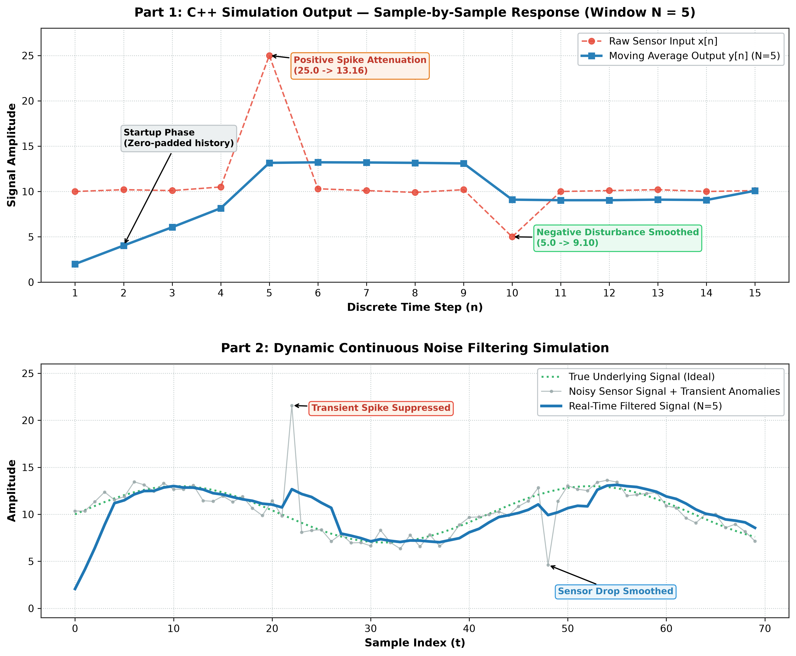

# Real-Time Digital Signal Processing & Noise Filter Simulation

[](https://isocpp.org/)
[](https://www.python.org/)
[](https://cmake.org/)
[]()
[](https://www.nitkkr.ac.in/)

A high-performance software-based discrete-time **Moving-Average Finite Impulse Response (FIR) Filter** simulation in **C++17**, paired with dynamic signal visualization and test benchmarking in **Python**.

This implementation utilizes a **fixed-size circular buffer** combined with a **running sum algorithm** to achieve guaranteed **$\mathcal{O}(1)$ constant-time processing per sample** with zero dynamic memory reallocations during runtime.

---

## 📊 Visual Results & Simulation Benchmarks

Below is the graphical comparison generated from the filter algorithm showing both discrete sample testing and continuous live noise suppression.



### Key Observations from the Results:

| Phase / Event | Raw Input $x[n]$ | Filtered Output $y[n]$ | Engineering Analysis |
| :--- | :---: | :---: | :--- |
| **Startup Transient** (Steps 1–4) | 10.00 – 10.50 | 2.00 – 8.16 | Zero-padded history is initially flushed as new samples enter the window buffer. |
| **Positive Transient Spike** (Step 5) | **25.00** | **13.16** | A massive transient shock (+150%) is heavily attenuated by **47.4%** across the 5-sample window. |
| **Negative Disturbance** (Step 10) | **5.00** | **9.10** | A sudden sensor voltage dip is smoothed out, preventing sudden downstream controller shock. |
| **Steady-State Recovery** (Steps 11–15) | ~10.00 – 10.20 | ~9.04 – 10.08 | Smooth baseline restoration with continuous high-frequency jitter suppression. |

---

## ⚡ Core Features

- **$\mathcal{O}(1)$ Constant Time Execution:** Uses recursive running sum update: subtracting the oldest departing sample and adding the new arriving sample.
- **Fixed-Memory Circular Buffer:** Memory is pre-allocated on initialization ($\mathcal{O}(N)$ space), preventing heap fragmentation and runtime memory allocations.
- **Full C++17 Architecture:** Clean modular class architecture (`MovingAverageFilter`) with `update()`, `reset()`, and `windowSize()` accessors.
- **Comprehensive Documentation & Build:** Pre-configured with CMake, GCC MinGW, and VS Code `.vscode/` debug & build tasks.
- **Dual Verification:** Includes C++ command-line simulation and an animated real-time Python graphical test bench (`live_filter.py`).

---

## 📐 Mathematical Formulation

### 1. Discrete Time-Domain Moving-Average FIR Filter
For an input sequence $x[n]$ and a filter window length $N$:

$$y[n] = \frac{1}{N} \sum_{k=0}^{N-1} x[n-k]$$

All filter coefficients are identical: $b_k = \frac{1}{N}$ for $k = 0, 1, \dots, N-1$.

### 2. $\mathcal{O}(1)$ Running Sum Recurrence Relation
Instead of re-summing all $N$ elements at every step ($\mathcal{O}(N)$), the running sum $S[n]$ is updated incrementally:

$$S[n] = S[n-1] + x[n] - x[n-N]$$

$$y[n] = \frac{S[n]}{N}$$

### 3. Circular Buffer Ring Indexing
The buffer pointer wraps around smoothly without shifting array memory:

$$\text{index}_{new} = (\text{index}_{old} + 1) \pmod N$$

---

## 🗂️ Project Directory Structure

```text
signal-filter-project/
├── .vscode/                     # VS Code tasks & debug configuration
│   ├── c_cpp_properties.json
│   ├── launch.json
│   └── tasks.json
├── assets/                      # High-resolution benchmark figures
│   └── simulation_results.png
├── docs/                        # Complete technical documentation
│   └── project_report.md
├── include/                     # C++ header files
│   └── MovingAverageFilter.hpp
├── src/                         # C++ source code
│   ├── main.cpp
│   └── MovingAverageFilter.cpp
├── CMakeLists.txt               # CMake multi-platform build definition
├── generate_plots.py            # Matplotlib script for generating 300 DPI report plots
├── live_filter.py               # Real-time animated dynamic signal simulator
├── .gitignore                   # Excludes build binaries and cache files
└── README.md                    # Project documentation & benchmark overview
```

---

## 🚀 Build and Execution Guide

### Option 1: Direct Build with GCC (MinGW / Linux / macOS)

```bash
# Compile
g++ -std=c++17 -Wall -Wextra -Wpedantic -Iinclude src/main.cpp src/MovingAverageFilter.cpp -o signal_filter

# Run on Windows:
.\signal_filter.exe

# Run on Linux/macOS:
./signal_filter
```

### Option 2: Build using CMake

```bash
# Generate build configuration
cmake -S . -B build

# Build project
cmake --build build

# Execute binary
.\build\Debug\signal_filter.exe     # Windows MSVC / MinGW
# or ./build/signal_filter          # Linux / macOS
```

### Option 3: Real-Time Animated Python Visualization

Ensure `numpy` and `matplotlib` are installed:
```bash
pip install numpy matplotlib
```

Run the live interactive simulation:
```bash
python live_filter.py
```

Re-generate high-res figures:
```bash
python generate_plots.py
```

---

## 📋 Sample C++ Console Output

```text
========================================================
 Real-Time DSP Simulation: Moving Average FIR Filter
 Window size: 5 samples
========================================================
    Step       Raw Input     Filtered Output
--------------------------------------------------------
       1           10.00                2.00
       2           10.20                4.04
       3           10.10                6.06
       4           10.50                8.16
       5           25.00               13.16
       6           10.30               13.22
       7           10.10               13.20
       8            9.90               13.16
       9           10.20               13.10
      10            5.00                9.10
      11           10.00                9.04
      12           10.10                9.04
      13           10.20                9.10
      14           10.00                9.06
      15           10.10               10.08
========================================================
Note: startup outputs include zero-padded history.
```

---

## 👤 Author & Academic Details

- **Author:** Neeraj
- **Roll Number:** 123104020
- **Department:** Electrical Engineering
- **Institution:** National Institute of Technology, Kurukshetra
- **GitHub Repository:** [dhariwalneeraj-ops/signal-filter-project](https://github.com/dhariwalneeraj-ops/signal-filter-project)
